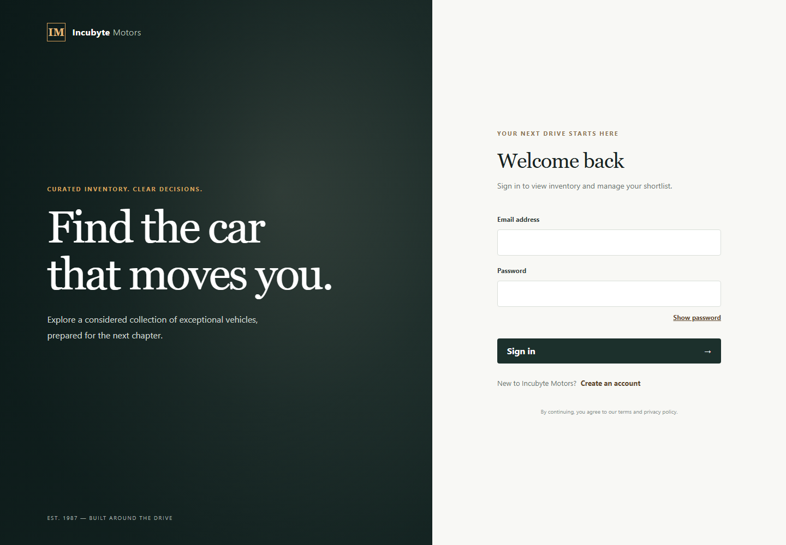
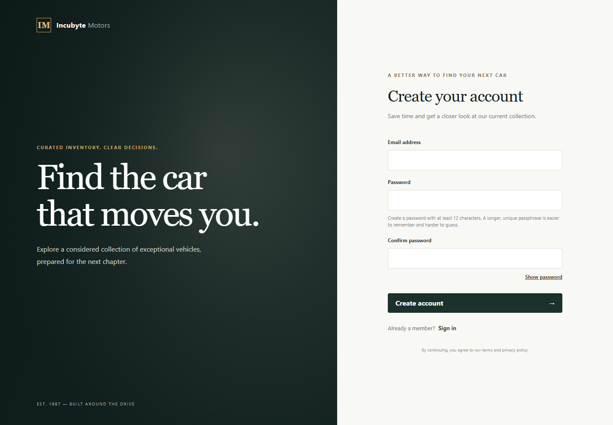
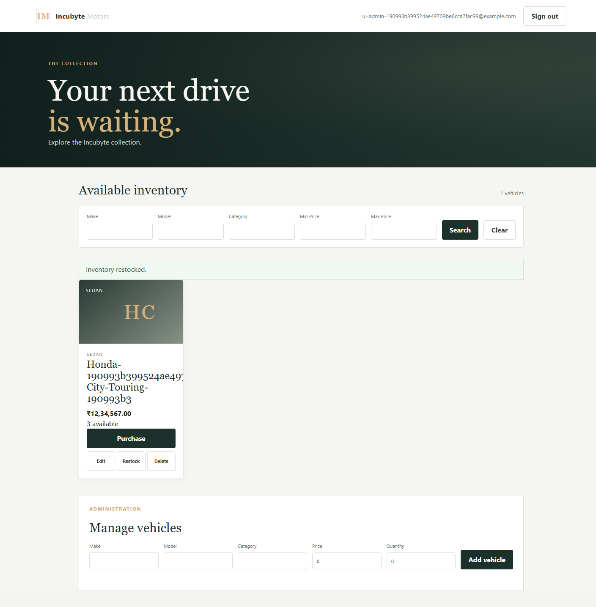
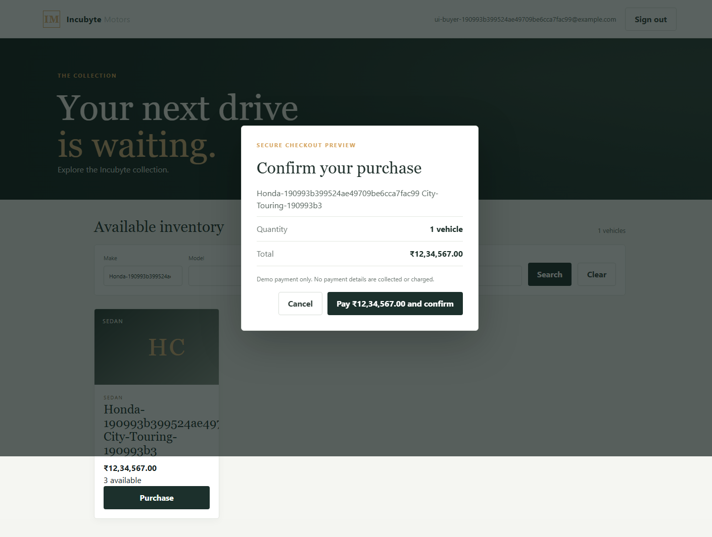

# Car Dealership Inventory System

A full-stack dealership inventory application. Users can register, sign in, search vehicles, and complete a demo checkout before confirming a one-unit purchase. Administrators can create, update, delete, and restock vehicles. PostgreSQL-backed inventory updates are transaction-safe. See [the implementation plan](docs/implementation-plan.md), [requirements](docs/requirements.md), and [the API contract](docs/api-contract.yaml).

## Technology

- Frontend: React, TypeScript, Vite, React Router, Tailwind CSS.
- Backend: Python 3.12+, FastAPI, SQLAlchemy 2.x, Alembic, Pydantic.
- Database: PostgreSQL 16 using Docker Compose for local development.
- Tests: Pytest/HTTPX and Vitest/React Testing Library.

## Prerequisites

- Python 3.12 or later and Node.js/npm.
- Docker Desktop or another Docker Compose implementation for PostgreSQL.

## Local setup

1. Create local environment files from the templates:

   ```powershell
   if (!(Test-Path .env)) { Copy-Item .env.example .env }
   if (!(Test-Path backend/.env)) { Copy-Item backend/.env.example backend/.env }
   if (!(Test-Path frontend/.env)) { Copy-Item frontend/.env.example frontend/.env }
   ```

2. Replace `POSTGRES_PASSWORD` in root `.env` with a local-only password (the Compose file requires it). The backend `DATABASE_URL` must use matching database/user/password values. `backend/.env.example` is a template and must be updated to match your local database password.

3. Start PostgreSQL:

   ```powershell
   docker compose up -d db
   ```

4. Install the backend and development dependencies:

   ```powershell
   cd backend
   python -m venv .venv
   .\.venv\Scripts\Activate.ps1
   python -m pip install -e ".[dev]"
   ```

5. Apply the PostgreSQL schema migrations and run the API:

   ```powershell
   alembic upgrade head
   uvicorn app.main:app --reload
   ```

   `GET /health` checks process health. Authentication and vehicle routes are described in the API contract.

6. After migration, provision the initial administrator interactively:

   ```powershell
   python -m app.cli create-admin
   ```

   Password input is hidden. Public registration always creates a regular user. The bootstrap command refuses to run after an administrator exists.

7. In a second terminal, install and run the frontend:

   ```powershell
   cd frontend
   npm install
   npm run dev
   ```

   Set `VITE_API_BASE_URL` in `frontend/.env` if the backend is hosted somewhere other than `http://localhost:8000`.

## Configuration

- `POSTGRES_DB`, `POSTGRES_USER`, `POSTGRES_PASSWORD`, and optional `POSTGRES_PORT` configure the local Compose database.
- `DATABASE_URL`, `JWT_SECRET_KEY`, `JWT_ALGORITHM`, `ACCESS_TOKEN_EXPIRE_MINUTES`, `CORS_ORIGINS`, and `ENVIRONMENT` configure the backend.
- `TEST_DATABASE_URL` is optional and must point to a separate PostgreSQL database ending in `_test`; only then will PostgreSQL integration tests run.
- `VITE_API_BASE_URL` configures the frontend API base URL.
- `.env.example` files contain placeholders only. Never commit actual `.env` files or use local sample secrets outside development.

## Verification status

Verification on 2026-10-25 used Python 3.14.3 and the configured PostgreSQL test database:

| Check | Result |
| --- | --- |
| `cd backend; python -m pytest --cov=app --cov-report=term-missing -q` | 31 passed; 88% total application coverage |
| `cd backend; python -m pytest -q -m integration` | 4 passed; 27 deselected |
| `cd backend; python -m pytest -q tests/test_postgres_api_e2e.py` | 1 isolated PostgreSQL API workflow passed |
| `cd frontend; npm test` | 15 passed |
| `cd frontend; npm run typecheck` | Passed |
| `cd frontend; npm run lint` | Passed with no warnings |
| `cd frontend; npm run build` | Passed |
| `git diff --check` | Passed |

PostgreSQL workflow tests cover authentication, admin vehicle lifecycle, search, purchase, restock, delete, and concurrent purchase behavior against the isolated `dealership_test` database. The repeatable API E2E test registers/logs in a user, provisions/logs in a test admin, searches, verifies no stock change before purchase confirmation, then checks purchase, out-of-stock, restock, update, and delete through HTTPX. A live browser run against a temporary API configured to `dealership_test` also passed registration/login, filtering, cancel/confirm purchase with stock update, and admin create/update/restock/delete. Temporary records and test processes were removed. See the [Phase 5 integration report](test-reports/phase-5-integration.md) for exact setup and results.

## Screenshots

Login and registration screenshots captured from the running frontend:









## My AI Usage

OpenAI Codex assisted with planning, API-contract work, backend authentication and inventory implementation, frontend workflows, tests, migration/setup work, and documentation. Generated changes were checked against `docs/requirements.md` and the API contract, then reviewed through pytest, Vitest, type-checking, linting, builds, live API requests, and an isolated browser workflow. The test-first process was followed for the initial authentication slice and the payment-confirmation UI; several later backend CRUD/search/stock tests were written after implementation, so the complete Red-Green-Refactor history is not demonstrated. Codex helped find setup and test-harness issues, including a malformed database URL, missing Vite environment typing, and an IPv4/IPv6 mismatch during isolated browser testing. Human intervention supplied PostgreSQL access and confirmed the desired INR display and demo-only checkout. No payment service is connected. Raw conversation records in `PROMPTS.md` still contain placeholders and must be replaced with authentic logs or links before submission; no conversations were fabricated.

## Known limitations

The checkout is a demo confirmation only and does not collect payment details or charge money. Screenshots cover login, registration, the admin dashboard, and checkout. The live browser workflow ran against a temporary backend connected to `dealership_test`, not the development database. `PROMPTS.md` still needs authentic raw conversation logs or public chat links before final submission. Backend coverage is 88%; unit coverage gaps are concentrated in CLI/configuration and some auth/service branches, and the project records the historical TDD gap above.
